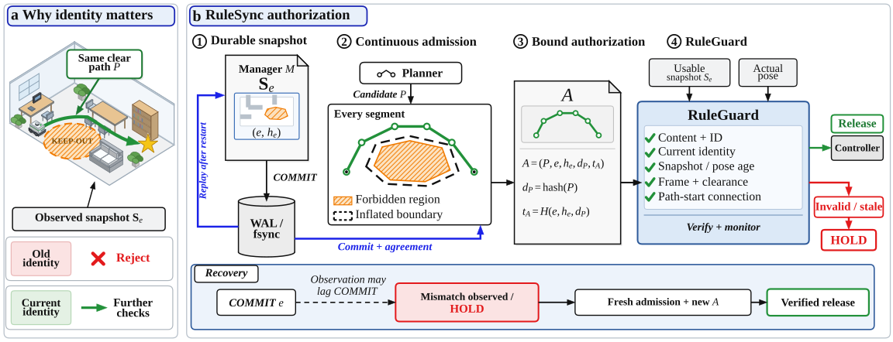

<h1 align="center">RuleSync</h1>

<p align="center"><strong>Durable authorization for modular robot navigation</strong></p>
<p align="center">ROS 2 · Nav2 · Rule snapshots · Execution authorization</p>
<p align="center"><a href="rulesync/">Source code</a> · <a href="artifacts/jsa_20261116/">Data</a> · <a href="docs/RULESYNC_REPRODUCIBILITY_20261116.md">Reproduction guide</a> · <a href="docs/README_ZH.md">中文导读</a></p>

<p align="center"><a href="docs/assets/rulesync-overview.svg"></a></p>

**A path can remain clear after the rule decision authorizing it has changed.** RuleSync carries complete rule-snapshot identity through continuous path admission and content-bound execution authorization. An independent receiver checks usable observed state and actual pose; invalidation latches HOLD until fresh admission supplies new permission. Existing planners and controllers retain their roles.

Source code and reproduction records are available directly on the default **main** branch.

## Quick start

Offline verification uses Python 3.10 or newer and runs without ROS, Gazebo or robot hardware.

```bash
git clone https://github.com/Yule-Cai/R2I-RL.git
cd R2I-RL
python3 -m venv .venv-rulesync
source .venv-rulesync/bin/activate
python -m pip install -r requirements-rulesync.txt
bash scripts/check_rulesync_offline.sh
python scripts/verify_jsa_release.py
bash scripts/check_jsa_harnesses.sh
```

For ROS workspace setup and manager, bridge, gate and RuleGuard interfaces, see [rulesync/README.md](rulesync/README.md).

## Source code

| Directory | Role |
|:---|:---|
| [rulesync/](rulesync/) | ROS 2 messages/services, durable manager, Nav2 bridge and RuleGuard adapter |
| [rulesync3d/](rulesync3d/) | Planar/volumetric geometry, content binding and monitor core |
| [topopatch_ros/](topopatch_ros/) | Independent path admission and navigation integration |
| [rulepatch_ros/](rulepatch_ros/) | Controller and navigation compatibility components |
| [scripts/](scripts/) | Offline tests, data verification and analysis |
| [experiments/](experiments/rulesync_experiments/) | Frozen navigation and message-diagnostic harnesses |

## Data and verification

| Records | Included evidence |
|:---|:---|
| Navigation | 2,970 trial rows across 23 layouts, with original outcomes and missing-data categories |
| Receiver probes | Original 500-file archive for 12 typed-message attempts |
| Attribution diagnostics | Three separately counted raw archives and publication ledgers |
| Admission cost | 720 paired ROS measurements, warmups and workload summaries |
| Recovery and geometry | Protocol matrices, renewal timing records, a matched moving update and volumetric assessments |
| Fixed inputs | 197 pinned campaign files and 93 manifest-checked scientific data sources |

Start with [the artifact index](artifacts/jsa_20261116/README.md) and [the reproduction guide](docs/RULESYNC_REPRODUCIBILITY_20261116.md). Full bulk motion logs and upstream HSSD meshes are stored separately; the guide identifies the coverage of the included records.

<details>
<summary><strong>Regenerate numerical visualizations</strong></summary>

```bash
python -m pip install matplotlib pillow
python scripts/reproduce_jsa_figures.py --out output/jsa-regenerated-figures
```

The wrapper writes to a new directory and preserves the frozen input bytes.

</details>

## Version and reuse

The default branch contains the current source. The `rulesync-jsa-20261116` tag is retained as a versioned entry point for existing references. Dependency and dataset terms apply to their respective materials.

**Contact:** Yule Cai · [cai_yule@soc.uum.edu.my](mailto:cai_yule@soc.uum.edu.my)
