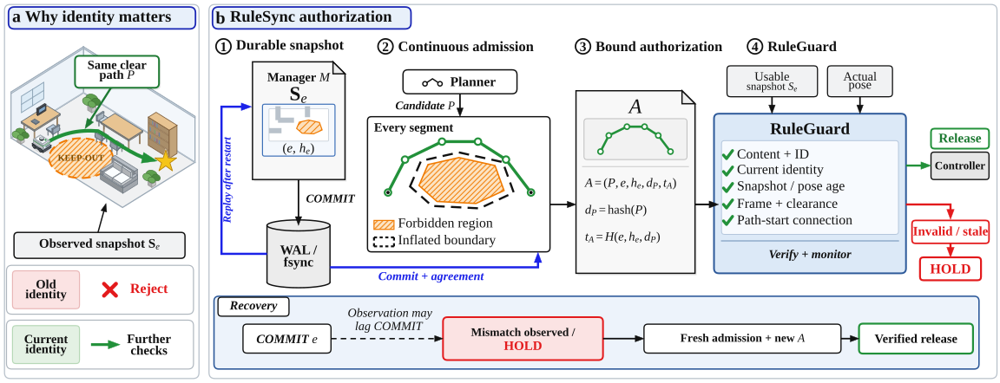

# RuleSync 中文导读

**把已提交的规则状态，连接到具体路径的执行许可。** RuleSync 面向模块化机器人导航：路径即使仍然畅通，也可能已经不再由当前规则版本授权。系统通过完整快照、连续路径准入、内容绑定和独立执行端检查，明确运动由哪个规则决策授权。

[项目首页](../README.md) · [离线核验](#快速核验) · [ROS 2接入](../README.md#ros-2-integration) · [最终36次评估](../artifacts/moving_update_20261117/README.md) · [历史数据目录](../artifacts/jsa_20261116/README.md) · [完整复现说明](RULESYNC_REPRODUCIBILITY_20261116.md)



代码和复现材料直接位于默认 **main** 分支，无需切换开发分支。

**新增完整运动中更新评估：36次、18对，36次重新授权，35次满足固定20cm独立到达判据。** [逐次结果](../artifacts/moving_update_20261117/trial_results.csv)与[独立核验入口](../artifacts/moving_update_20261117/README.md)均已提供。

## 机制主线

| 环节 | 作用 | 代码入口 |
|:---|:---|:---|
| 持久化决策 | WAL与COMMIT保留完整快照，重启后重建已选定目标 | [管理器](../rulesync/src/rulesync_manager/rulesync_manager/manager_node.py) |
| 部署一致性 | 检查参与方的epoch和快照哈希是否与目标一致 | [Nav2桥接](../rulesync/src/rulesync_nav2_bridge/rulesync_nav2_bridge/bridge_node.py) |
| 连续路径准入 | 检查每一段路径与膨胀禁行区的关系 | [几何Gate](../rulesync3d/rulesync3d/gate2d.py) |
| 内容绑定 | 将具体路径、规则身份和摘要放入完整授权对象 | [授权工具](../rulesync3d/rulesync3d/authorization.py) |
| 执行与恢复 | 根据可用观测和实际位姿检查授权；失效后HOLD，重新准入后恢复 | [RuleGuard](../rulesync/src/rulesync_guard/rulesync_guard/guard_node.py) |

规划器和控制器保留各自职责。RuleGuard依据接收端实际观测到的规则状态决策；COMMIT、观测、HOLD、重新释放和最终到达分别记录。

## 从哪种方式开始

| 目的 | 环境 | 推荐入口 |
|:---|:---|:---|
| 检查算法与数据 | Python 3.10+，Linux或macOS | 下方快速核验 |
| 接入ROS导航栈 | Linux、ROS 2、Nav2及相应依赖 | [ROS 2集成说明](../README.md#ros-2-integration) |
| 复现实验场景 | 原始场景资产、固定输入、记录中的镜像与资源配置 | [实验复现说明](RULESYNC_REPRODUCIBILITY_20261116.md) |

## 快速核验

离线命令不启动ROS、Gazebo或机器人硬件。

```bash
git clone https://github.com/Yule-Cai/R2I-RL.git
cd R2I-RL
python3 -m venv .venv-rulesync
source .venv-rulesync/bin/activate
python -m pip install -r requirements-rulesync.txt

bash scripts/check_rulesync_offline.sh
python scripts/verify_jsa_release.py
bash scripts/check_jsa_harnesses.sh
python scripts/verify_final_moving_update.py
```

前三个入口分别核对核心算法/恢复契约、科学数据/原始记录、固定实验/观察器契约。最后一个入口独立复核最终36次运动更新评估，单独使用时仅需Python 3.9+标准库。没有ROS环境时，依赖ROS的测试会跳过；其它离线核验可以独立运行。

数据核验结果写入`artifacts/jsa_20261116/verification_latest.json`，细分收据位于其`qa/`目录。

## ROS 2接入要点

记录中的评估环境使用ROS 2 Lyrical、Nav2和Gazebo。完整工作区构建命令见[英文首页](../README.md#ros-2-integration)，包与接口见[ROS包说明](../rulesync/README.md)。ROS终端使用系统Python环境，离线虚拟环境用于纯Python核验。

集成流程为：准备世界、地图与定位 → 启动管理器和桥接 → 启动Gate与独立RuleGuard → 将控制器路径输入接到执行端输出。

```bash
ros2 launch rulesync_demo rulesync_sim.launch.py
```

上面的入口启动管理器和Nav2桥接；仿真世界、Nav2、Gate和控制器由所选集成或实验运行器提供。

```bash
ros2 launch rulesync_demo rulesync_guard.launch.py \
  pose_topic:=/ruleguard/pose \
  executable_topic:=/rulepatch/executable_path
```

实际位姿必须为规则坐标系中的`PoseStamped`。控制器应订阅经过RuleGuard核验的路径输出。失效后再次收到新鲜快照不会自动解除HOLD，恢复需要新的路径准入和完整授权。

### 当前源码默认参数

| 参数 | 默认值 | 含义 |
|:---|:---:|:---|
| `rule_frame` | `map` | 规则与位姿坐标系 |
| `rho` | `0.20 m` | 几何膨胀/净空半径 |
| `snapshot_poll_s` | `0.20 s` | 快照查询间隔 |
| `snapshot_stale_s` | `1.00 s` | 可用观测最大年龄 |
| `snapshot_request_timeout_s` | `1.00 s` | 查询超时 |
| `pose_stale_s` | `0.50 s` | 位姿最大年龄 |
| `path_start_tolerance` | `0.25 m` | 实际位姿与路径起点的连接距离上限 |

这些是当前源码默认值；历史实验参数以各自清单为准。独立Gate覆盖硬禁行区几何；速度字段进入快照身份和Nav2传播，几何路径本身不规定时间化速度曲线。

## 最终36次运动更新评估

固定3条路线、3个种子、正常/2.5秒响应缺失以及Full/geometry-only两组，共36次、18对。全部完成重新授权；35次达到独立目标位置判据，剩余一次21.08cm超过固定20cm，原始FAIL保留。

| 指标 | 本轮记录 |
|:---|:---|
| 完整执行与独立复核 | 36/36次、18/18对 |
| 正常Full身份失效HOLD | 9/9；COMMIT后中位85.8ms |
| 正常geometry-only保留旧执行状态 | 9/9 |
| 响应缺失Full观测过期HOLD | 9/9；COMMIT后中位989.9ms |
| 最终命令发布、数值和仿真桥接take关联 | 58,211条 |
| 更新窗口内采样身体侵入 | 0/36 |

[结果索引](../artifacts/moving_update_20261117/trial_results.csv) · [完整证据与复核说明](../artifacts/moving_update_20261117/README.md)。HOLD、稳定零命令发布、采样运动与任务到达分别统计；本轮数据不与早期pilot或开发资格验证合并。

## 数据与实验入口

| 材料 | 内容 |
|:---|:---|
| `source_data/` | 93份哈希固定数据，含2970行导航、720对准入测量、恢复计时、协议和三维评估 |
| `receiver12_raw.tar.gz` | 12次真实消息探针的原始500文件档案 |
| `source_data/diagnostic_raw/` | 3次单独计数的原始诊断档案 |
| `frozen_inputs/` | 197份固定地图、路线、世界引用和辅助源码 |
| `evidence/` | 冻结实现、组件测试及预期绑定/锁存结果 |

以上材料位于[artifacts/jsa_20261116/](../artifacts/jsa_20261116/)。完整大体积导航/三维运动日志与HSSD源场景资产另行保存；现有数据摘要不等同于全部原始轨迹。

所有当前实验运行器位于[experiments/rulesync_experiments/](../experiments/rulesync_experiments/)，其中：

- `formal_dualmap_20261108_v2/`：固定正式矩阵、契约、队列与运行器。
- `authorization_diagnostic_20261115/`：探针逻辑、观察器账本与诊断运行器。
- `quad3d_snapshot_dev_20261114_v3/`：快照对齐的三维实现与审计来源。

原始失败和缺测保留在各自数据中；不同实验族和DEV诊断各自计数。

### 重生成数值图

```bash
python -m pip install matplotlib pillow
python scripts/reproduce_jsa_figures.py --out output/jsa-regenerated-figures
```

指定一个新的输出目录。包装脚本在临时工作区运行，保留冻结输入。

## 版本、引用与联系

main提供当前源码布局，`rulesync-jsa-20261116`标签保留已有版本引用。软件引用方式见[CITATION.md](../CITATION.md)，依赖与数据分别遵循其来源条款。

联系人：Yule Cai · [cai_yule@soc.uum.edu.my](mailto:cai_yule@soc.uum.edu.my)
